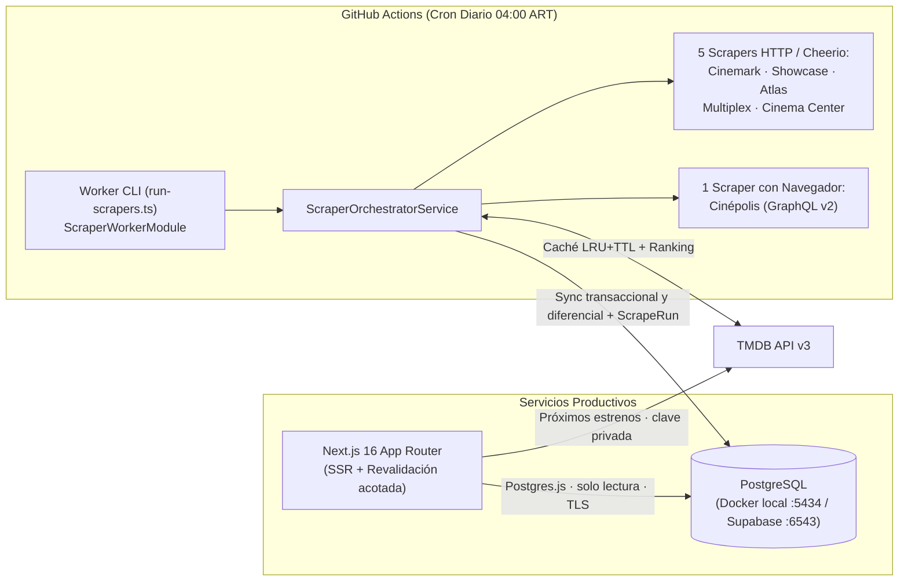

# 🎬 Cine Radar — Agregador de Cartelera de Cines en Argentina

**Cine Radar** es una plataforma Full-Stack que consolida en una sola interfaz la cartelera, funciones multi-día, formatos (`2D`, `3D`, `IMAX`, `4D`, `XD`, `D-BOX`, `VIP`, `COMFORT`), idiomas y geolocalización de **68 complejos pertenecientes a 6 cadenas de cine de Argentina**, enriqueciendo cada título con metadatos oficiales de **TMDB**.

| Cadena | Complejos configurados | Mecanismo de recolección |
| :--- | :---: | :--- |
| **Cinemark Hoyts** | 22 | API BFF JSON directa (`api-ar.cinemarkhoyts.com.ar`) |
| **Cinema Center** | 17 | Endpoint AJAX HTML + `cheerio` por ciudad |
| **Cinépolis** | 10 | GraphQL Storefront v2 en contexto aislado de navegador (`puppeteer`) |
| **Showcase** | 7 *(8 feeds incl. IMAX Norcenter)* | API JSON VoyAlCine (`entradas.todoshowcase.com`) |
| **Atlas Cines** | 7 | API REST JSON por complejo |
| **Multiplex** | 5 | HTML SSR + `cheerio` |
| **Total** | **68 complejos** | Sincronización programada diaria (`04:00 ART`) |

> **Alcance de actualización:** La plataforma **no** realiza scraping en vivo durante las peticiones de los usuarios. Un worker CLI programado sincroniza diariamente la cartelera hacia PostgreSQL a las `04:00` (`America/Argentina/Buenos_Aires`), y Next.js consulta ese snapshot directamente desde el servidor con un usuario de Supabase de solo lectura. No requiere desplegar NestJS. La ejecución programada puede degradarse ante fallos de proveedores; Atlas devuelve 403 desde los runners alojados de GitHub en la última comprobación.

---

## 🏗️ Arquitectura del Sistema



---

## 🧠 Decisiones Técnicas e Integridad Operativa

### 1. Reemplazo Transaccional y Sincronización Diferencial
- **Atomicidad por sede (`prisma.$transaction`)**: La actualización de horarios de cada complejo ocurre dentro de una transacción acotada al rango de días cubierto por la extracción, evitando dejar un cine vacío si falla una escritura intermedia.
- **Sincronización diferencial (`M2`)**: Antes de reescribir una sede, el orquestador compara las claves compuestas `(movieId, dateTime, format, language)` y `ticketUrl` entrantes contra el rango existente; si el snapshot no cambió, omite `DELETE` e `INSERT` por completo.
- **Contrato explícito de 4 estados (`complete` · `empty_verified` · `partial` · `failed`)**: Distingue una cartelera genuinamente vacía (`empty_verified`) de una caída de red o cambio de esquema (`failed` / `partial`). Ante fallos parciales o totales se preservan las funciones vigentes; el CLI devuelve código de salida distinto de cero cuando falla una cadena por completo.

### 2. Concurrencia Segura sobre Connection Poolers
- **Leases distribuidos en SQL (`ScraperLock`)**: En lugar de `pg_advisory_lock` de sesión (incompatible con PgBouncer/Supavisor en modo transacción `:6543`), el worker adquiere leases atómicos con expiración TTL en tabla PostgreSQL (`scraper:global` y `scraper:chain:<key>`).
- **Separación entre lectura web y Worker**:
  - Next.js usa un lector dedicado; las credenciales del worker no se comparten con el navegador ni con el acceso web. [Configuración y pruebas](docs/NEXT-SUPABASE-SIN-NEST.md).
  - La API NestJS se conserva como herramienta opcional de desarrollo:
  - `AppModule` sirve tráfico HTTP con `ENABLE_HTTP_SCRAPER="false"` por defecto, cabeceras `Helmet`, CORS de orígenes exactos, validación estricta (`ValidationPipe` + pipes de enteros de 32 bits y fechas calendario reales) y `@nestjs/throttler` consciente de proxy (`TRUST_PROXY`).
  - `ScraperWorkerModule` levanta únicamente los proveedores de extracción y persistencia para `run-scrapers.ts`, sin controladores HTTP, `ThrottlerModule` ni `ScheduleModule`. En despliegues de la API (`api/nixpacks.toml`) y CI se define `PUPPETEER_SKIP_DOWNLOAD="true"` para evitar descargas innecesarias de Chromium.

### 3. Resolución Determinística de Películas y Resiliencia HTTP
- **Identidad desacoplada (`MovieIdentityService`)**: Cada película posee `normalizedKey` único independiente de `tmdbId` (nullable) y estado `tmdbStatus` (`matched` | `not_found` | `pending`). Si TMDB falla transitoriamente durante el scraping, la función se publica con identidad local y se reconcilia automáticamente en corridas posteriores sin duplicar registros.
- **Ranking de candidatos y caché acotada**: `TmdbService` puntúa coincidencias exactas normalizadas, pistas de año y ventana de estreno, deduplica promesas concurrentes (*in-flight*) y acota memoria con `BoundedTtlCache` (LRU + TTL diferenciado para aciertos y ausencias confirmadas).
- **Observabilidad (`GET /health`, `ScrapeRun` y `ChainScrapeState`)**: Liveness en `GET /`; readiness comprueba PostgreSQL en cada sondeo. La frescura se calcula por cadena con un umbral de 36 horas y distingue fallos de vacíos verificados, sin convertir datos degradados en un fallo de arranque. Las métricas se reutilizan 15 segundos y el historial se depura por lotes tras 30 días. Semántica, benchmark y límites en [Etapa 4](docs/ETAPA-4-OPERACION-EVIDENCIA.md).

---

## 🛠️ Stack y Requisitos

- **Node.js**: `22.x LTS` (requerido también para ejecutar la suite de tests nativos de `web` con `--experimental-strip-types`)
- **Docker**: Docker Desktop / Engine con Compose v2 (para PostgreSQL 15 local)
- **Backend (`/api`)**: NestJS 11, TypeScript 5, Prisma 6, Axios, Cheerio, Puppeteer Extra Stealth, Jest + Supertest
- **Frontend (`/web`)**: Next.js 16 (App Router), React 19, Tailwind CSS v4, Radix UI (`Dialog`), Framer Motion, `date-fns`

---

## 🚀 Puesta en Marcha Local (Paso a Paso Verificado)

El entorno local utiliza **puertos separados** para evitar colisiones:
- **PostgreSQL (Docker)**: `localhost:5434`
- **Backend API (NestJS)**: `http://localhost:3001` (Swagger en `http://localhost:3001/docs`)
- **Frontend Web (Next.js)**: `http://localhost:3000`

### 1. Levantar PostgreSQL local con Docker
Desde la raíz del repositorio:
```bash
docker compose up -d
```

### 2. Configurar variables de entorno
Copiar las plantillas incluidas en ambos paquetes:
```bash
cp api/.env.example api/.env
 # setup-web-reader.cjs crea web/.env.local con credenciales nuevas
```
Para Supabase, seguir [la configuración del lector y despliegue web](docs/NEXT-SUPABASE-SIN-NEST.md). El mismo script admite PostgreSQL de localhost para el entorno Docker.

Editar `api/.env` completando `TMDB_API_KEY` (obtener en [themoviedb.org](https://www.themoviedb.org/settings/api)) y un valor aleatorio para `ADMIN_API_KEY`. La URL de base de datos por defecto en `api/.env.example` ya apunta al contenedor local en `localhost:5434`.

### 3. Instalar, migrar y poblar catálogo (`/api`)
```bash
cd api
npm ci
npm ci --prefix ../web      # El script de configuración utiliza el driver web
npx prisma migrate deploy   # Aplica todas las migraciones versionadas en orden
npm run db:seed             # Carga las 6 cadenas y los 68 complejos geolocalizados
npm run build               # Compila dist/ (requerido antes de scrape:prod)
npm run scrape:prod         # Opcional: pobla cartelera (ej. una cadena: node dist/cli/run-scrapers.js atlas)
node scripts/setup-web-reader.cjs # Crea lector y configura web/.env.local
# npm run start:dev         # API opcional; Next ya no la necesita
```
> **Nota sobre `Cinépolis` en local:** Las 5 cadenas HTTP (`atlas`, `multiplex`, `showcase`, `cinemark`, `cinemacenter`) funcionan sin navegador externo. Para recolectar `cinepolis` localmente se requiere Google Chrome/Chromium instalado y definir `PUPPETEER_EXECUTABLE_PATH` apuntando al binario local si se instaló con `PUPPETEER_SKIP_DOWNLOAD="true"`.

### 4. Instalar e iniciar el Frontend (`/web`)
En una segunda terminal:
```bash
cd web
npm ci
npm run dev                 # Inicia Next.js en http://localhost:3000
```

---

## 🧪 Verificación y Calidad (CI)

El workflow [`.github/workflows/ci.yml`](./.github/workflows/ci.yml) valida cada Pull Request sobre PostgreSQL 15 efímero sin tocar servicios externos:

```bash
# Backend (/api)
cd api
npm run lint:check          # ESLint sin warnings ni mutación de archivos
npm test                    # Tests unitarios (scrapers con fixtures locales, orquestador, caché, DTOs)
npm run test:e2e            # Contratos HTTP, CORS, validación y readiness /health
npm run test:browser        # TEST_POSTGRES_URL local: Next + DB real + Chrome; sin NestJS
npm run build

# Frontend (/web)
cd ../web
npm run lint
npx next typegen && npx tsc --noEmit
npm test                    # Transporte HTTP de TMDB, fechas y navegación
npm run build
```

---

## ⚠️ Limitaciones Conocidas y Avisos Legales

- **Cobertura y fuentes externas**: Los horarios provienen de sitios y endpoints públicos de exhibidores terceros cuyas estructuras HTML/JSON pueden cambiar sin previo aviso. Cuando un proveedor altera su contrato, el scraper afectado reporta `failed` o `partial` y preserva el último snapshot válido hasta ajustar el adaptador correspondiente.
- **Carácter informativo**: La disponibilidad de butacas, precios finales y eventuales reprogramaciones de último momento dependen exclusivamente de cada cadena exhibidora.
- **Atribución TMDB**: *This product uses the TMDB API but is not endorsed or certified by TMDB.* Los pósters, sinopsis y calificaciones provienen de [The Movie Database (TMDB)](https://www.themoviedb.org/).
